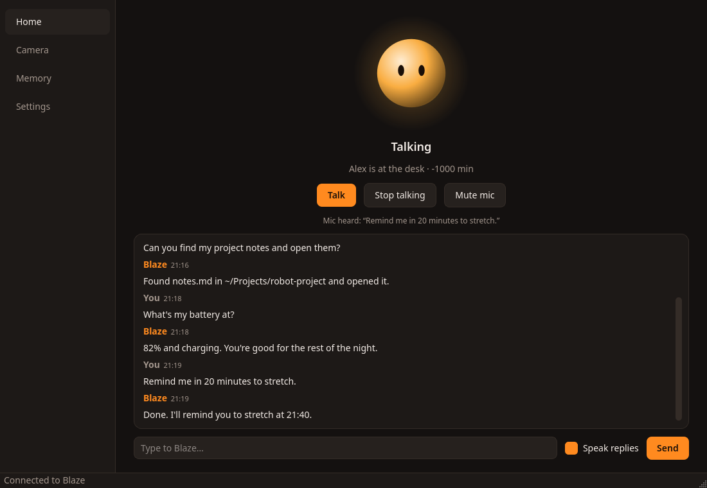
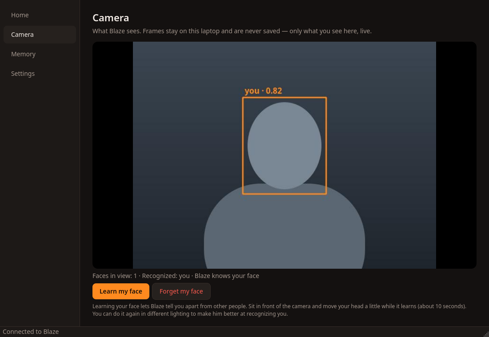
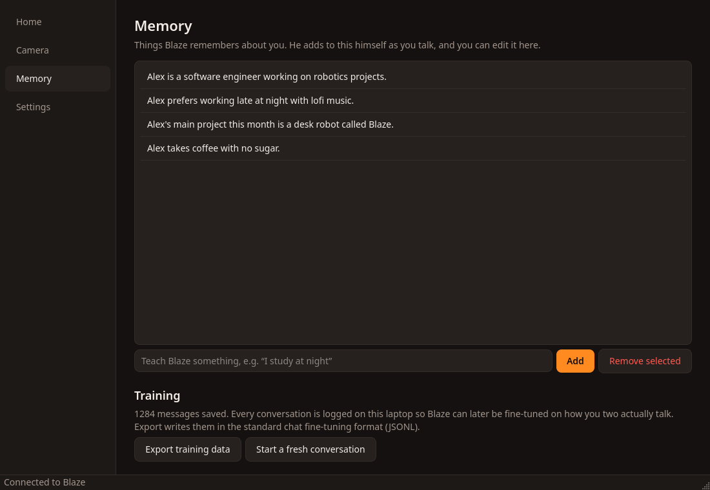
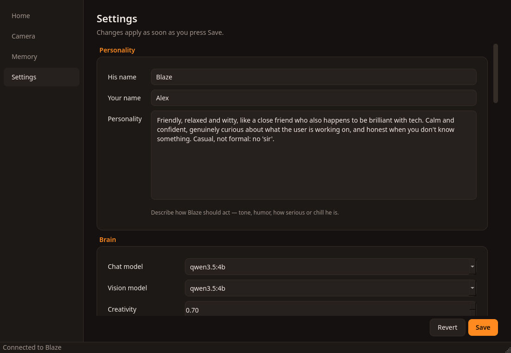
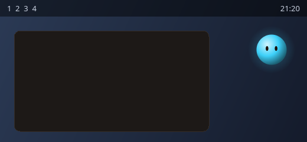

<p align="center">
  
</p>

<h1 align="center">Blaze</h1>

<p align="center">
  An always-on AI desk partner for Linux. He sees you through the webcam, talks with you by voice,
  remembers who you are, and runs your laptop for you: all locally, with open-source models.
</p>

<p align="center">
  
</p>

## What he does

- **Talks with you.** Say *"Hey Blaze, …"* and have a normal back-and-forth conversation. After that
  you don't need to repeat his name. You can interrupt him mid-sentence.
- **Sees you.** He notices when you sit down or leave, recognizes *your* face, welcomes you back,
  reminds you to take breaks, and can look at what you're holding up to the camera.
- **Runs your laptop.** He finds files, searches inside them, opens apps and files, switches and closes
  windows, controls volume, brightness and music, takes screenshots, sets timers, and runs shell
  commands. Anything risky waits for your OK. Web pages open in your own default browser.
- **Looks things up.** He searches the web for anything current (prices, scores, releases, people),
  reads a page when the snippets aren't enough, and gets the weather and the latest news. While he
  searches he says "let me check", so you're never left in silence. Search runs through a private
  SearXNG server on your machine, with no account or API key.
- **Remembers you.** He picks up lasting facts about you as you talk, and you can edit them. Every
  conversation is logged locally so you can later fine-tune his model on how the two of you talk.
- **Always there.** He runs as a systemd user service: he starts when you log in, restarts if he crashes,
  stops when you shut down, and handles suspend and resume.
- **Private.** Everything runs on your machine. Camera frames and audio are processed in memory and never saved.
  Only web searches leave your laptop, and only when you ask for something he has to look up.
- **Quick to answer.** He starts speaking as soon as his first sentence is written. He knows when you've
  finished talking without being fooled by typing or background voices. The whole model sits on the GPU
  and stays loaded.

| | |
|---|---|
|  |  |
| **Camera:** live view, presence and face recognition | **Memory:** what he knows about you, plus training data export |
|  |  |
| **Settings:** every option, applied instantly | **Bubble:** floats on every workspace; click it to open the app |

## How it works

```
 Webcam ─► face detection + recognition (OpenCV) ─┐
 Mic ─► voice detection ─► speech-to-text ────────┼─► Brain (LLM + tools) ─► text-to-speech ─► speaker
                                                  │        │
                                    Memory (SQLite)        └─► Hands: files, apps, windows, media, shell,
                                                                  web search (SearXNG), news, weather
```

| Part   | Uses |
|--------|------|
| Brain  | [Ollama](https://ollama.com): a small tool-calling chat model plus a vision model (`qwen3.5:4b` does both) |
| Ears   | [Silero VAD](https://github.com/snakers4/silero-vad) + [faster-whisper](https://github.com/SYSTRAN/faster-whisper) on the CPU |
| Voice  | [Kokoro](https://github.com/thewh1teagle/kokoro-onnx) (local, free) or [ElevenLabs](https://elevenlabs.io) (cloud) |
| Eyes   | OpenCV YuNet (face detection) + SFace (face recognition) |
| Hands  | `fd`, `ripgrep`, `hyprctl`, `pactl`, `brightnessctl`, `playerctl`, `grim` |
| Web    | [SearXNG](https://docs.searxng.org) (local, in Docker), [ddgs](https://github.com/deedy5/ddgs) for news and as a fallback, [wttr.in](https://wttr.in) for weather, [trafilatura](https://trafilatura.readthedocs.io) to read pages |
| App    | PySide6 (Qt 6) |

## Requirements

- Linux with PipeWire or PulseAudio, a webcam and a microphone
- [uv](https://docs.astral.sh/uv/) and [Ollama](https://ollama.com)
- An NVIDIA GPU with 4 GB or more is recommended (it also runs on CPU, just slower)
- Optional tools for laptop control: `fd`, `ripgrep`, `grim`, `playerctl`, `brightnessctl`
- [Docker](https://docs.docker.com/engine/install/) for web search (optional, see below)
- [Hyprland](https://hyprland.org) for window control, the floating bubble and the push-to-talk key.
  The rest works on any desktop.

## Install

```sh
git clone <this repo> blaze && cd blaze
uv sync                        # Python 3.12 environment with everything
ollama pull qwen3.5:4b         # the brain (chat, tools and vision in one model)
.venv/bin/blaze install        # voice + face models, autostart, app launcher, `blaze` command
```

`blaze install`:
- downloads the Kokoro voice and the OpenCV face models (about 400 MB)
- creates the `blaze` and `blaze-ollama` systemd user services and enables them
- adds a *Blaze* entry to your app launcher and puts `blaze` in `~/.local/bin`
- on Hyprland, writes `~/.config/hypr/blaze.conf` (the bubble, its window rule and SUPER+M) and
  adds one `source` line to `hyprland.conf`

For web search, run [SearXNG](https://docs.searxng.org), a private search server, in Docker.
It searches Google, Bing, DuckDuckGo and others for Blaze, without an account:

```sh
mkdir -p ~/.config/blaze/searxng
cat > ~/.config/blaze/searxng/settings.yml <<EOF
use_default_settings: true
server:
  secret_key: "$(openssl rand -hex 32)"
  limiter: false
  image_proxy: false
search:
  formats: [html, json]
EOF
docker run -d --name blaze-searxng --restart unless-stopped -p 127.0.0.1:8888:8080 --memory 400m \
  -v ~/.config/blaze/searxng:/etc/searxng:rw searxng/searxng:latest
```

Without it, search falls back to scraping Yahoo and DuckDuckGo, which often comes back empty. To use
Ollama's or Brave's search API instead, pick it in **Settings → Computer control → Web search** and
paste an API key. Weather (wttr.in) and news need no setup.

Then open the app and set **Settings → Personality → Your name**. Set **Brain → Chat model** and
**Vision model** to `qwen3.5:4b`.

## Use

| To… | Do this |
|---|---|
| Talk to him | Say **"Hey Blaze, …"**, then keep talking normally. Say "bye" to end the conversation. |
| Talk without the wake word | Press **SUPER+M**, or click **Talk** in the app |
| Interrupt him | Just start talking (headphones recommended) |
| Open the app | Click the bubble, pick *Blaze* in your launcher, or run `blaze` |
| Quick actions | Right-click the bubble |
| Look something up | *"Hey Blaze, what's the bitcoin price?"*, *"…will it rain tomorrow?"*, *"…any cricket news?"* |
| Open a website | *"Open YouTube"*, *"play Westlife on YouTube"*, *"open Gmail"*: opens in your default browser |
| Use him from a script | `blaze chat "…"`, `blaze say "…"`, `blaze mute`, `blaze unmute`, `blaze status` |

He asks before doing anything risky, such as running a command or closing a window. Answer by voice,
or with the Yes/No bar in the app.

## Settings

Everything is in the app and saved to `~/.config/blaze/settings.json`:

- **Personality:** his name, your name, and how he behaves
- **Brain:** chat and vision models, creativity, how much conversation he keeps in mind
- **Voice:** Kokoro voice, speed, volume and speaker, or ElevenLabs (API key and voice ID)
- **Listening:** wake words, how long a conversation stays open, speech model, language, microphone,
  talk-over
- **Camera:** device, how often he looks around, greeting and break reminders
- **Computer control:** allow shell commands, confirm risky actions, search folders, web search
  engine (free/local, or Ollama or Brave with an API key)
- **Startup:** start at login, start, restart or stop the service

## Teaching him over time

1. **Memory.** He saves facts about you as you talk. Edit them on the Memory page.
2. **Your face.** Camera → *Learn my face*. Repeat it in different lighting to make recognition sturdier.
3. **Habits.** When you sit down and leave is logged in the `events` table of `~/.local/share/blaze/blaze.db`.
4. **Fine-tuning.** Memory → *Export training data* writes every conversation as chat-format JSONL.
   Use it for a LoRA fine-tune (for example with Unsloth on Colab), then load the result into Ollama
   with a `Modelfile`.

To check how well a model picks tools: `.venv/bin/python scripts/eval_tools.py qwen3.5:4b qwen2.5:3b`

## Project layout

```
src/blaze/
  daemon.py       Blaze himself: wires everything together
  brain.py        Ollama chat, tool calling, vision, learning facts
  hands.py        laptop-control tools
  web.py          web search, news, weather, reading pages
  ears.py         microphone + voice activity detection
  stt.py          speech → text
  voice.py        text → speech
  eyes.py         presence + face recognition
  memory.py       SQLite memory and conversation log
  settings.py     all settings
  ipc.py          daemon ↔ app socket protocol
  cli.py          the `blaze` command and installer
  gui/            the desktop app and the floating bubble
scripts/
  eval_tools.py   how reliably a model picks the right tool
  screenshots.py  regenerates the README screenshots from demo data
docs/screenshots/ images used in this README
```

## Troubleshooting

```sh
journalctl --user -u blaze -f          # live logs: everything he hears and says
systemctl --user restart blaze         # restart him
blaze uninstall                        # remove services, launcher and Hyprland config (keeps your data)
```

- **He doesn't react to "Hey Blaze".** Check the *Mic heard:* line on the Home page. If his name is
  being misheard, add that spelling under Settings → Listening → Wake words.
- **He interrupts himself.** You're probably on speakers. Turn off Settings → Listening →
  *Let me talk over him*.
- **Web search finds nothing.** Check that SearXNG is up: `docker ps` should list `blaze-searxng`,
  and `curl "http://127.0.0.1:8888/search?q=test&format=json"` should return results.
- **Links open in the wrong browser.** He uses your default browser. Set it with
  `xdg-settings set default-web-browser google-chrome.desktop` (or your browser's `.desktop` file).
- **His replies are weak.** Use a bigger or newer model. Small (3B) models struggle with tool use and
  following instructions.
